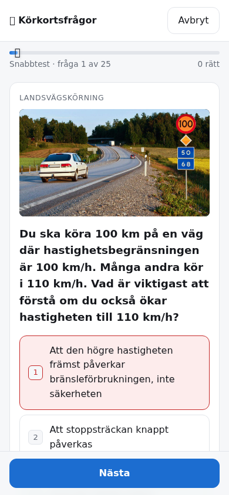

# Körkortsfrågor

Övningsprov inför det svenska teoriprovet för B-körkort:
**<https://korkort.eliasf.se>**

1865 frågor med förklaring till varje svar, bildfrågor och videofrågor.
Statisk sida — nginx serverar `site/`, all quizlogik ligger i webbläsaren och
statistiken sparas bara i din egen `localStorage`. Enda serverdelen är en
liten tjänst för dagliga påminnelser, som du själv väljer att slå på.

<p align="center">
  
</p>

## Funktioner

- **Provet** — 65 frågor, 52 rätt för godkänt, rättas först på slutet, precis
  som Trafikverkets prov. **Snabbtest** — 25 blandade frågor som rättas direkt.
- **Öva på ett område** — nio kategorier, från Vägmärken till Mörker & Halka.
- **Repetera misstag** — frågor du svarat fel på sparas och kan köras om.
- Genomgång efter provet med förklaring, bild och ditt svar per fråga.
- Tangentbord: `1`–`9` svarar, `Enter` går vidare.
- **Daglig påminnelse** — en notis vid vald tid de dagar du inte har övat
  (Web Push; på iPhone krävs att appen lagts till på hemskärmen).
- **Installerbar app (PWA)** med offlineläge — appskalet och hela frågebanken
  cachas, media sparas efter hand som du ser den.

## Frågebanken

`site/data/questions.json` är den sammanslagna banken: två insamlade källor i
ett gemensamt format.

| Källa | Frågor | Media |
|---|---:|---|
| ikorkort.nu (fria övningsbanken) | 1435 | 1173 bilder, 55 videoklipp |
| Ta Körkort-appens exam-databas | 430 | 330 bilder |

```json
{
  "id": "ikorkort-1",
  "source": "ikorkort",
  "category": "Miljö",
  "tags": ["sparsam-korning"],
  "question": "Vilket av följande påståenden om sparsam körning är korrekt?",
  "options": ["...", "...", "...", "..."],
  "answer": 3,
  "image": "images/bil36_b.jpg",
  "video": null,
  "explanation": ["stycke", "stycke"]
}
```

`image`/`video` är relativa till `site/media/`. `answer` pekar in i `options`,
som blandas både vid bygget och vid varje omgång i webbläsaren.

Kategorierna är ikorkort.nu:s åtta (Bilen, Stadskörning, Landsvägskörning,
Olyckor, Mörker & Halka, Människan, Miljö, Vägmärken). Ta Körkorts kapitel
mappas dit de motsvarar varandra (Fordonskännedom → Bilen, Personliga
förutsättningar → Människan, Miljö → Miljö); resten, mest kapitlet "Quiz",
hamnar i **Blandat**.

Bortvalt vid sammanslagningen: Ta Körkorts 50 videofrågor (klippen ligger på
privata Vimeo-id:n som inte går att spela upp, vilket gör frågorna
obesvarbara) och 3 dubbletter.

## Bygga

Råmaterialet ligger under `sources/`. Skripten är fristående `uv`-skript utan
projektberoenden.

```bash
./build.py           # sources/ -> site/data/questions.json
./fetch_media.py     # hämtar bilder och videoklipp till site/media/
./make_icons.py      # ritar om PWA-ikoner och delningsbild
```

Media (drygt 750 MB) ligger **inte** i git — `fetch_media.py` hämtar det från
källornas ursprungliga URL:er. Utan det fungerar sidan, men bildfrågorna
saknar bild.

## Påminnelser

`push/` är en Bun-tjänst som tar emot Web Push-prenumerationer och skickar
påminnelserna. Den ligger på samma värdnamn under `/api/push`:

| Anrop | |
|---|---|
| `GET /api/push/key` | VAPID-nyckeln webbläsaren prenumererar med |
| `PUT /api/push/subscription` | `{subscription, time, timeZone, confirm?}` — skapa eller uppdatera |
| `DELETE /api/push/subscription` | `{endpoint}` — avsluta |
| `POST /api/push/practiced` | `{endpoint}` — har övat i dag, ingen påminnelse |
| `GET /api/push/health` | hälsokoll |

Servern sparar per prenumeration bara push-adressen med nycklar, vald tid,
tidszon och vilka datum påminnelsen skickades respektive du övade — i
`push/data/push.sqlite`, tillsammans med VAPID-nycklarna som skapas vid första
start. **Tappas databasen slutar alla prenumerationer att fungera** (appen ber
då om att slå på påminnelserna igen). Endpoints godtas bara från webbläsarnas
egna push-tjänster, så tjänsten kan inte användas för att anropa godtyckliga
adresser.

Varje minut skickas påminnelser till dem vars valda tid har passerat i deras
egen tidszon, max en gång per dag och inte om de redan har svarat på en fråga
samma dag. En missad påminnelse (t.ex. efter omstart) skickas upp till tre
timmar sent.

```bash
cd push && bun install && bun test       # tidslogiken
DATA_DIR=/tmp/push bun server.ts         # lokalt på :3000
```

## Drift

```bash
docker compose up -d --build   # nginx:alpine med site/ read-only + push-tjänsten
```

Traefik-routrar på `korkort.eliasf.se`, publika: `korkort` (nginx) och
`korkort-push` (`PathPrefix(/api/push)`). Hälsokoll: `/health` respektive
`/api/push/health`.

## Om materialet

Frågorna är upphovsrättsskyddat material från ikorkort.nu respektive Ta
Körkort, insamlat för eget bruk — sidan är inte en officiell källa och har
ingen koppling till Trafikverket. Trafikverkets riktiga prov innehåller 65
räknade frågor där 52 rätt krävs för godkänt, vilket "Provet" härmar.
